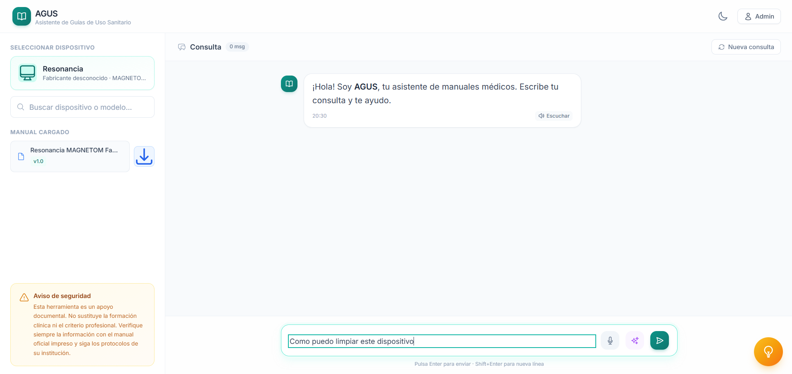
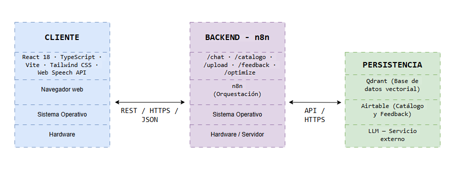
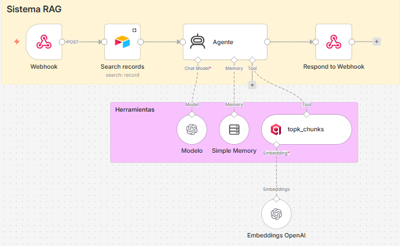
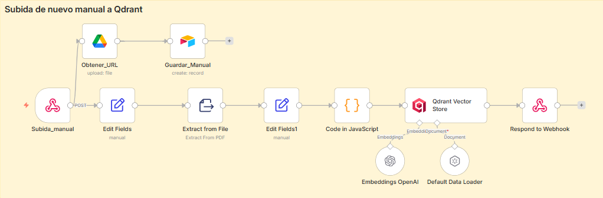
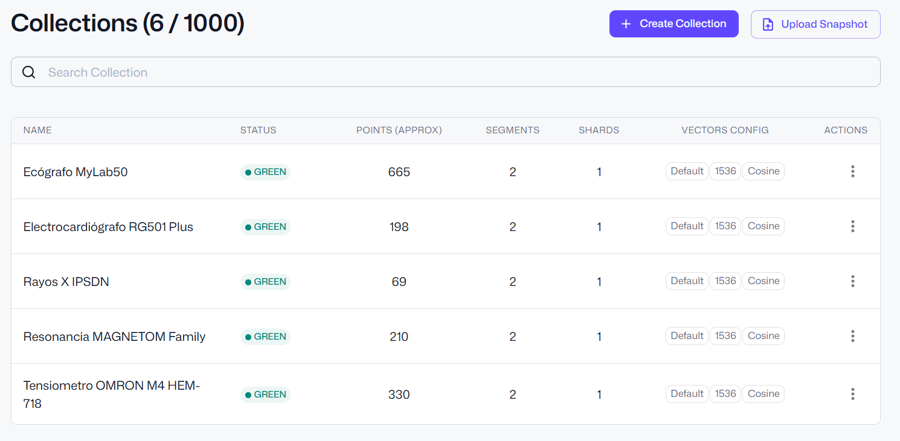
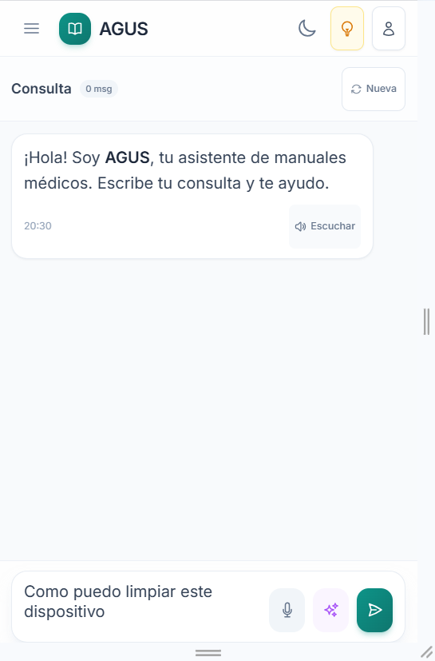
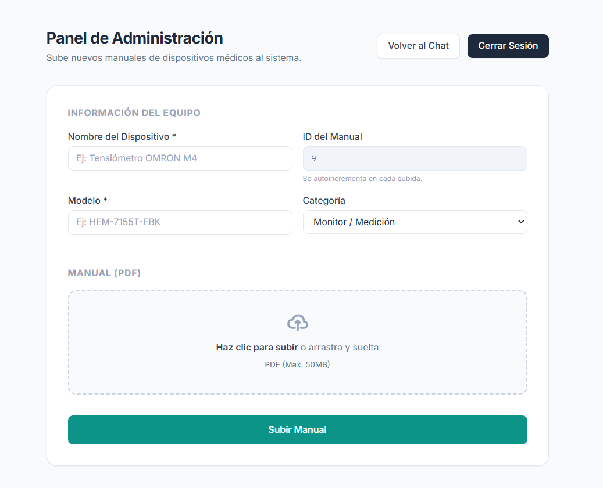

# AGUS — Agentic RAG Assistant for Medical Device Manuals

**AGUS** (*Asistente de Guías de Uso Sanitario*) lets hospital staff ask technical questions about medical equipment in natural language and get answers grounded **only** in the official manual of that device. Staff scan a QR code on the equipment, the app opens with that device preselected, and they can type or dictate their question.

Built as my Biomedical Engineering final degree project (Universidad de Alicante, 2026).



## Why

When an alarm goes off or a device needs configuring, clinicians still dig through PDF or paper manuals that run to hundreds of pages. AGUS cuts that search down to a short conversation, and refuses to answer anything that isn't in the manual: no diagnoses, no prescriptions, no invented steps.

## Architecture



| Layer | Stack |
|---|---|
| Frontend | React 18, TypeScript, Vite, Tailwind CSS, Web Speech API (voice input) |
| Orchestration (backend) | n8n: 5 HTTPS webhooks (`/chat`, `/catalogo`, `/upload`, `/optimize`, `/feedback`) |
| LLM | OpenAI `gpt-5-mini` inside an n8n AI Agent node (tool calling + short-term memory) |
| Retrieval | OpenAI embeddings (1536-d, cosine) stored in **Qdrant**, one collection per manual |
| Data | Airtable (device catalog, feedback log), Google Drive (original PDFs) |

### How a question is answered



1. The user selects a device (or arrives via its QR code). This fixes the Qdrant collection for the whole conversation, so manuals never get mixed up.
2. The frontend sends the message, session id, manual id and history to the `/chat` webhook.
3. An **AI Agent** (gpt-5-mini, 5-turn memory) decides whether to call the `topk_chunks` tool. The tool embeds the question and runs a similarity search over that manual's collection (top-k = 20).
4. The agent answers **only** from the retrieved chunks. If the information isn't there, it says so explicitly, and it asks for clarification when a question is ambiguous (e.g. *"flow sensor or O2 cell?"*).

### Manual ingestion



An admin uploads a PDF from the admin panel. One branch stores the file in Google Drive and registers it in Airtable; the other extracts the text, cleans and chunks it in a custom JavaScript node, embeds it and writes it to a new Qdrant collection with metadata (`manual_id`, `chunk_id`, `chunk_index`, `source`, ...).



### Other workflows
- **Query optimizer** (`/optimize`): a tool-less agent that rewrites informal questions into precise ones (*"how do I calibrate this"* → *"What is the step-by-step procedure to calibrate the device?"*).
- **Feedback triage** (`/feedback`): stores suggestions in Airtable, sends a confirmation email, and uses an agent to format the report for the technical team.

### Screenshots

| Mobile (QR access) | Admin panel |
|---|---|
|  |  |

## Evaluation

Tested on manuals for 4 real devices (blood pressure monitor, portable X-ray, ultrasound scanner, ICU ventilator) with a battery of **100 queries** across four categories: direct (40), comprehension (30), out-of-scope (20) and ambiguous (10). The full list is in [`evaluation/100_consultas.md`](evaluation/100_consultas.md).

- **100%** correct on direct lookups (tables, error codes, parameters)
- **93%** on comprehension questions (the misses were overly verbose answers, not wrong ones)
- **0 hallucinations**: every out-of-scope request (diagnoses, drug doses, etc.) was refused
- Average latency of 15–25 s per answer (n8n + LLM round trip)
- Usability test with 8 users: **4.4 / 5** average across 10 items

## Engineering notes

- **Adaptive response parser** (`frontend/src/services/api.ts`): n8n returned the answer under different JSON keys (`output`, `response`, `text`, nested arrays...). A recursive extractor walks the payload by key priority, so the UI never breaks when the workflow output changes.
- **Resilience**: 60 s request timeout with `AbortController`, backend health check, and a local demo mode with a fallback catalog when the webhooks are unreachable.
- **Multilingual mode removed on purpose**: translating answers on the fly lowered accuracy on Spanish-only manuals, so I dropped it for safety.

## Limitations & next steps

- **Auth is demo-only**: the admin login is a client-side check. Production would need server-side auth (hospital SSO) and role-based access to collections.
- **Citations**: return page/section references with every answer (the `ManualSource` type is already in place).
- **Retrieval**: hybrid search (BM25 + vectors) for exact error codes, plus a reranker over the top-20 results.
- **Structure-aware chunking** for tables, which are the most critical content in manuals.
- **Automated evaluation**: run the 100-query set as a regression test on every prompt or model change.
- **Backend in code** (FastAPI + LangChain/LangGraph) for versioning, testing and scale; optional local LLM for on-prem hospital deployments.
- Clinical pilot with real staff at Hospital General Universitario de Alicante (in preparation).

## Run the frontend locally

```bash
cd frontend
cp .env.example .env   # point the webhook URLs to your own n8n instance
npm install
npm run dev
```

Without configured webhooks the app runs in demo mode with mock answers. The n8n workflows themselves are not included in this repository.

## Author

**Agustín Lucas Barberán**: Biomedical Engineer, MSc in AI (in progress).
